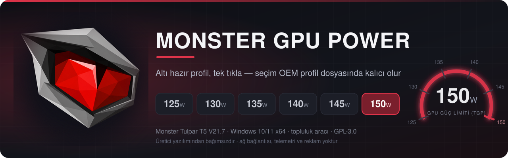
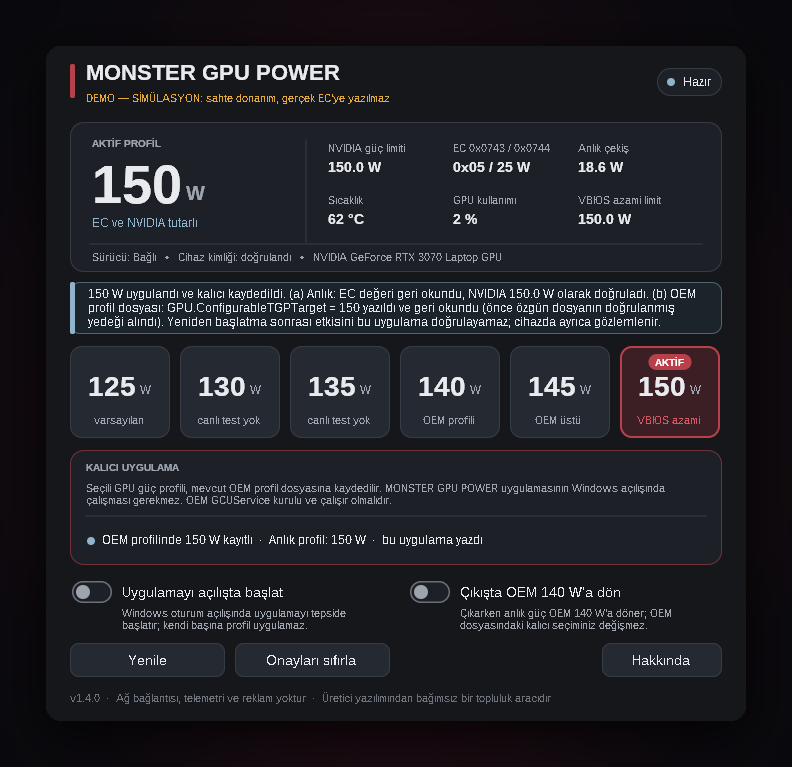

<div align="center">



<br>


[Türkçe](README.md) · **English**

</div>

> [!NOTE]
> The application UI, installer and the primary documentation are in **Turkish** ([README.md](README.md)). This page is a shorter English summary of the same facts.

> [!WARNING]
> **This tool targets exactly one machine:** Monster Tulpar T5 V21.7 (board tag GM5TG7Y), BIOS `N.1.07Mon08`, NVIDIA GeForce RTX 3070 Laptop GPU (VBIOS maximum 150 W).
> On any other model, BIOS or GPU the application **deliberately writes nothing**. Raising the GPU power limit above 140 W means more heat, fan noise and VRM load and may affect your warranty. You use it at your own risk.

## What it is

**MONSTER GPU POWER** lets you pick the GPU power limit (TGP) of a Monster Tulpar T5 V21.7 — **125, 130, 135, 140, 145 or 150 W** — with one click. The selected profile is **applied immediately and saved to the OEM profile file**, so it survives reboots without this app running.

<div align="center">


<sub>Main window. <b>This is a screenshot of the SIMULATION (demo) build with fake EC / NVIDIA / OEM-file back ends, not of real hardware.</b></sub>
</div>

## Features

- **Six one-click profiles**, always persistent — there is no "temporary" apply any more.
- **Two-layer, verified result.** First the live value (EC + NVIDIA driver, read back and verified), then the OEM profile file (written and read back). "Success" is only reported when both layers are verified; if one fails, the live change is rolled back and the rollback is verified.
- **Backup before every write.** The original file is copied byte-for-byte to a `.bak` next to it; backups are never deleted or overwritten.
- **Foreign-value protection.** If the file holds a value this app did not write (Control Center, an OEM update, a manual edit) it asks before replacing it; default answer is **No**.
- **Thermal and limit guards.** Profiles above 140 W are refused at GPU ≥ 80 °C; anything above the NVIDIA-reported maximum is refused.
- **Device identity check** (SMBIOS, BIOS version, GPU model) — on mismatch nothing is written.
- **Two settings only:** *Start with Windows (minimized)* and *Return to OEM 140 W on exit*.
- **About** button opens this repository.
- **No network, telemetry or ads.** No PowerShell/CMD/Python/helper programs are spawned.

## Profiles

| Profile | EC `0x0743` / `0x0744` | Evidence (owner's own measurements) |
|:---:|:---:|---|
| 125 W | `0x01` / 0 | measured live with OEM AutomaticOverboost off |
| 130 W | `0x05` / 5 | **expected mapping, not tested live** |
| 135 W | `0x05` / 10 | **expected mapping, not tested live** |
| 140 W | `0x05` / 15 | measured live (OEM's highest profile) |
| 145 W | `0x05` / 20 | EC + NVIDIA verified (idle probe) |
| 150 W | `0x05` / 25 | EC + NVIDIA verified; ~150 W measured under load |

## How persistence works

Persistence is **not** an EC or BIOS write. The manufacturer's Control Center service (`GCUService`) applies the active OEM profile's JSON file. This app changes only the three digits of one field, `GPU.ConfigurableTGPTarget`, in `Mode3_Profile1.json` (all other bytes are preserved), so the OEM service applies the chosen limit at boot. The OEM service must be installed and running; the app itself does not need to run at boot.

Writes happen only if all of these hold, otherwise **nothing is applied** and the reason is shown: running as administrator; `GCUService.exe` running from `C:\Program Files\OEM\Control Center\UniwillService\MyControlCenter\` with file version exactly **1.0.2.70**; `UserPofiles` is a real folder (no reparse points); `MainOption.json` has `OperatingMode = 2`, `TurboProfileIndex = 0`; `Mode3_Profile1.json` has `Activated = true`, `GPU.ConfigurableTGPSwitch = 1`, `GPU.DynamicBoostSwitch = 0` and a target of 125–150 W.

It does **not** touch: BIOS/UEFI, EC firmware (no flashing), `MainOption.json`, other JSON fields, the OEM service/drivers, the 230 W / 330 W adapter profiles, CPU limits, fan curves or NVIDIA settings.

## Compatibility

Supported (single target): SMBIOS manufacturer `MONSTER`, model `TULPAR T5 V21.7…`, BIOS `N.1.07Mon08`, RTX 3070 **Laptop** with a 150 W VBIOS maximum, Uniwill `ACPIDriver` (`ACPI\INOU0000`), Control Center `GCUService` 1.0.2.70.

**Not supported (blocked by design):** XMG NEO 15 (M21) / GM5TG7W and other machines of the same Tongfang GM5 chassis family, RTX 3060/3080 variants, other BIOS versions. Their EC mapping and OEM file layout are unverified, so the app disables the profile buttons and writes nothing. If you own such a machine you may open an [issue](../../issues/new?template=uyumluluk-raporu.md) with the output of the read-only PowerShell block in [README.md](README.md#cihazınızı-denetleyin-salt-okunur-powershell) — this is data for evaluation, not a promise of support.

### About the GPU VBIOS

This app does **not** touch the VBIOS: it does not run `nvflash`, does not distribute VBIOS files and does **not recommend** flashing one. The ceiling for all profiles is the power limit the VBIOS allows; if the NVIDIA driver does not report a maximum of **150 W**, the app refuses to write on that machine. Reaching 150 W therefore depends on the GPU already running a VBIOS with a 150 W maximum.

The author's own laptop runs a 150 W VBIOS from another vendor (MECHREVO GM7TG7M). That is **the author's own choice and risk, not a recommendation**. The author's observation: even with a 150 W VBIOS installed, the GPU cannot actually reach 150 W until the OEM-controlled extra power share (EC `0x0743` / `0x0744`) is enabled. This app sets that OEM share and makes it persistent in the OEM profile file. It does not patch the NVIDIA driver: when the EC share changes, the driver updates the limit it reports, and the app reads that back through NVML to verify.

VBIOS pages the author listed as references (their contents have **not been verified** by this project; a wrong VBIOS can make the GPU unusable and voids the warranty):

* MECHREVO 150 W: <https://www.techpowerup.com/vgabios/249133/249133>
* Clevo 150 W: <https://www.techpowerup.com/vgabios/256918/256918>

Author's notes: if experimenting with VBIOS files at all, only consider files whose Device ID and Subsystem ID are compatible, and keep the MUX switch disabled while testing. Not every upload on TechPowerUp is verified.

## Install / uninstall

Download `MONSTER_GPU_POWER_Setup.exe` (or the portable `MonsterGpuPower.exe`) from [Releases](../../releases/latest) and compare it with `SHA256SUMS.txt`. The app requests administrator rights. The binaries are **unsigned**, so SmartScreen may warn.

The app talks to the EC through the Uniwill `ACPIDriver` kernel driver. That driver belongs to the manufacturer and is **not included** here. See [docs/SURUCU_ABI.md](docs/SURUCU_ABI.md) (Turkish) for the IOCTL/EC map.

**Manual rollback:** select 140 W in the app, or copy a `Mode3_Profile1.json.mgp-original-….bak` file back over `Mode3_Profile1.json` (as administrator). Uninstalling does not touch the OEM file or the backups.

**Upgrading from v1.0–v1.3:** v1.4.0 removed temporary apply, "apply at Windows start", external-change monitoring/auto re-apply, "re-apply when the display wakes", and the log/diagnostics buttons. The installer deletes the legacy `MonsterGpuPower_ApplyAtLogon` scheduled task without applying anything.

## Validation status (honest)

**The app has not been run on real hardware yet.**

| What | Status |
|---|---|
| Unit tests (ASan + UBSan) | **101 tests / 1818 checks passed** |
| Wine + fake-hardware end-to-end GUI tests | **158 checks passed, 0 failed** — *simulation* |
| Installer (silent install, upgrade, uninstall) | **silent install 22/22, upgrade from v1.3.0 14/14 passed** — in Wine, *simulation* |
| **Real Windows 10/11 + real GM5TG7Y** | ❌ **NOT tested** — no real EC write and no real OEM JSON write has been done with this app |
| Real Task Scheduler behaviour | ❌ not tested (Wine has only partial emulation) |
| Reboot persistence of 125/130/135/145 W | ❌ not tested; the owner observed 150 W persisting across display cycles and reboots with their own PowerShell script using the same mechanism (JSON 140 → 150 W) |
| The PowerShell checks in the Turkish README | not run on a real Windows while writing them |

More: [docs/TEST_DURUMU.md](docs/TEST_DURUMU.md), [docs/CIHAZ_KABUL_TESTI.md](docs/CIHAZ_KABUL_TESTI.md) (Turkish).

## Build

```bash
make test        # unit tests (host, ASan+UBSan)
make exe         # build/MonsterGpuPower.exe  (mingw-w64 cross build)
make installer   # build/MONSTER_GPU_POWER_Setup.exe (NSIS)
python3 -I tools/verify_pe.py build/MonsterGpuPower.exe
```

## License and disclaimer

[GPL-3.0](LICENSE). This is an independent community project, **not affiliated with, endorsed or supported by** Monster Notebook, Casper, Uniwill, XMG, Tongfang, NVIDIA or Microsoft; trademarks belong to their owners. The software is provided "as is" without warranty. Changing power limits can stress your hardware thermally and electrically and may void your warranty; use it at your own risk.
