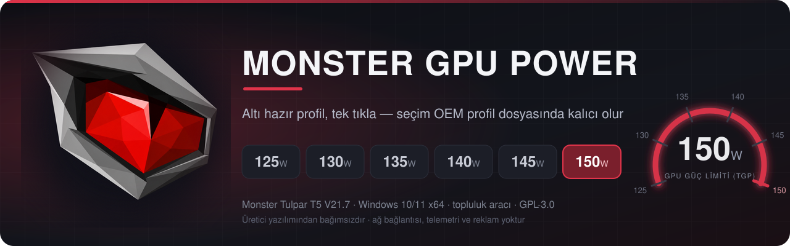
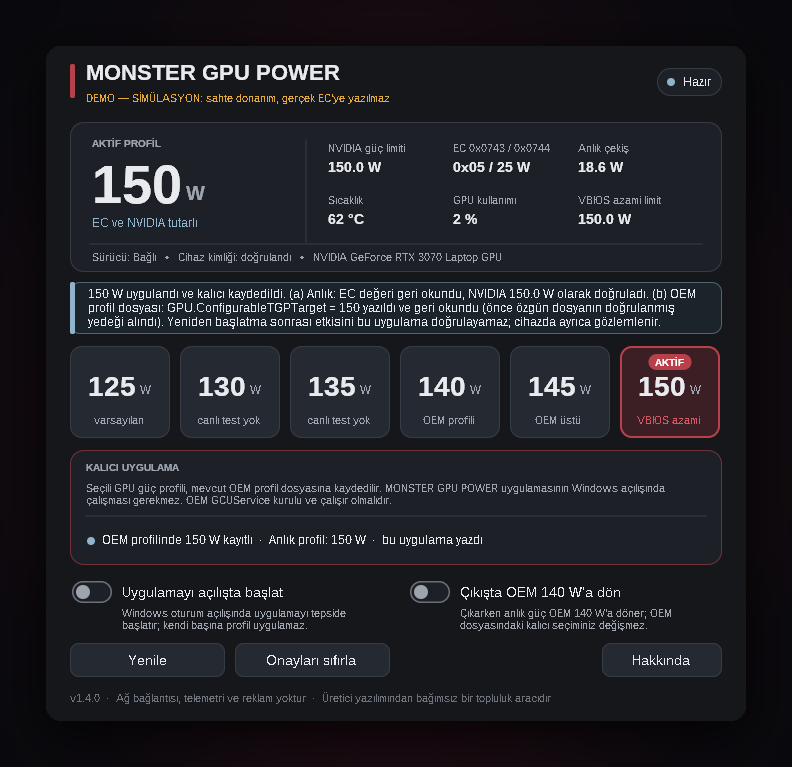
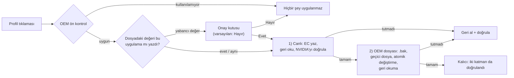

<div align="center">



<br>


**Türkçe** · [English](README.en.md)

</div>

> [!WARNING]
> **Bu araç yalnızca tek bir cihaz içindir:** Monster Tulpar T5 V21.7 (kart etiketi GM5TG7Y), BIOS `N.1.07Mon08`, NVIDIA GeForce RTX 3070 Laptop GPU (VBIOS azami 150 W).
> Başka model, BIOS veya GPU'da uygulama **bilerek hiçbir şey yazmaz** (bkz. [Uyumluluk](#uyumluluk)). Güç limitini 140 W'ın üstüne çıkarmak daha fazla ısı, fan gürültüsü ve VRM yükü demektir; garantiyi etkileyebilir. Sorumluluk size aittir ([Sorumluluk reddi](#sorumluluk-reddi)).

## Nedir?

**MONSTER GPU POWER**, Monster Tulpar T5 V21.7'nin GPU güç limitini (TGP) **125, 130, 135, 140, 145 veya 150 W** arasında tek tıkla seçmenizi sağlayan küçük bir Windows uygulamasıdır. Seçtiğiniz profil **anında uygulanır ve OEM profil dosyasına kaydedilir**: sonraki yeniden başlatmalarda uygulamayı çalıştırmanız gerekmez.

<div align="center">


<sub>Ana pencere. <b>Bu görüntü gerçek donanımdan değil, uygulamanın SİMÜLASYON (demo) derlemesinden alınmıştır</b> (sahte EC / NVIDIA / OEM dosyası); sürüm etiketi pencerede de belirtilmiştir.</sub>
</div>

## Özellikler

- **Altı hazır profil, tek tık.** 125 · 130 · 135 · 140 · 145 · 150 W. Her tıklama kalıcıdır; "geçici" uygulama yoktur.
- **İki katmanlı, doğrulanan sonuç.** Önce canlı değer (EC + NVIDIA sürücüsü, geri okunarak doğrulanır), sonra OEM profil dosyası (yazılır ve geri okunur). İki katman da doğrulanmadan "başarılı" denmez; biri tutmazsa canlı değişiklik **geri alınır** ve geri alma da doğrulanır.
- **Yazmadan önce yedek.** OEM dosyasındaki her değişiklikten önce özgün dosyanın tam bir kopyası `.bak` olarak yanına kaydedilir; yedekler hiçbir zaman silinmez veya ezilmez.
- **Yabancı değer koruması.** Dosyadaki değeri bu uygulama yazmadıysa (Control Center, OEM güncellemesi, elle düzenleme…) ezmeden önce sorar; varsayılan cevap **Hayır**'dır.
- **Sıcaklık ve sınır koruması.** 140 W'ın üstündeki profiller GPU 80 °C ve üzerindeyken uygulanmaz; NVIDIA'nın bildirdiği azami limitin üstü reddedilir.
- **Cihaz kimliği denetimi.** SMBIOS, BIOS sürümü ve GPU modeli beklenenle eşleşmezse hiçbir şey yazılmaz.
- **İki ayar, hepsi bu:** *Uygulamayı açılışta başlat* ve *Çıkışta OEM 140 W'a dön*.
- **Hakkında** düğmesi bu sayfaya götürür.
- **Ağ yok, telemetri yok, reklam yok.** Uygulama internete bağlanmaz.
- **Kabuk yok.** PowerShell, CMD, Python veya yardımcı program çalıştırmaz; EC'ye sürücü aygıtı üzerinden, OEM dosyasına doğrudan dosya işlemleriyle erişir.

## Profiller

| Profil | EC `0x0743` / `0x0744` | Arayüz etiketi | Kanıt düzeyi (cihaz sahibinin ölçümleri) |
|:---:|:---:|---|---|
| **125 W** | `0x01` / 0 | varsayılan | OEM AutomaticOverboost kapalıyken canlı ölçüldü |
| **130 W** | `0x05` / 5 | canlı test yok | **Beklenen eşleme; canlı denenmedi** |
| **135 W** | `0x05` / 10 | canlı test yok | **Beklenen eşleme; canlı denenmedi** |
| **140 W** | `0x05` / 15 | OEM profili | OEM açıkken canlı ölçüldü (üreticinin belirttiği en yüksek profil) |
| **145 W** | `0x05` / 20 | OEM üstü | EC + NVIDIA doğrulandı (yüksüz yoklama) |
| **150 W** | `0x05` / 25 | VBIOS azami | EC + NVIDIA doğrulandı; yükte ~150 W ölçüldü |

145 W ve 150 W için ve ilk kez 130/135 W için uygulama bir uyarı/onay kutusu gösterir; onay saklanır, "Onayları sıfırla" ile geri alınır.

## Nasıl çalışır?



OEM profil dosyası yoksa ya da beklenen durumda değilse (aşağıdaki koşullar) **hiçbir şey uygulanmaz**: uygulama yalnızca anlık, kalıcı olmayan bir değişiklik yapmaz.

### Kalıcılık neye dayanır?

Kalıcılık EC veya BIOS'a yazmak **değildir**. Mekanizma şudur:

1. Üreticinin Control Center'ının `GCUService` hizmeti, etkin OEM profilinin JSON dosyasını uygular.
2. Bu uygulama, o dosyadaki **tek bir alanın** (`GPU.ConfigurableTGPTarget`) üç hanesini değiştirir; dosyanın geri kalan her baytı korunur.
3. Böylece Windows açılışında GPU güç limitini OEM hizmeti uygular; bu uygulamanın çalışıyor olması gerekmez.

> Seçili GPU güç profili, mevcut OEM profil dosyasına kaydedilir. MONSTER GPU POWER uygulamasının Windows açılışında çalışması gerekmez. OEM GCUService kurulu ve çalışır olmalıdır.

Yazma yalnızca şu koşulların **hepsi** sağlanırsa yapılır (aksi halde pencerede nedeni yazılır ve hiçbir şey uygulanmaz):

| Koşul | Beklenen |
|---|---|
| Yetki | Uygulama yönetici olarak çalışıyor (manifest ister) |
| Hizmet | `GCUService.exe` çalışıyor; tam yolu `C:\Program Files\OEM\Control Center\UniwillService\MyControlCenter\GCUService.exe` |
| Hizmet sürümü | yalnızca **1.0.2.70** |
| Klasör | `…\MyControlCenter\UserPofiles` (OEM'in yazım hatası aynen) gerçek bir klasör; bağlantı/yönlendirme noktası yok |
| Etkin profil | `MainOption.json` içinde `OperatingMode = 2`, `TurboProfileIndex = 0` → etkin profil `Mode3_Profile1.json` |
| Profil dosyası | `Activated = true`, `GPU.ConfigurableTGPSwitch = 1`, `GPU.DynamicBoostSwitch = 0`, `GPU.ConfigurableTGPTarget` 125–150 W'tan biri |

### Neyi değiştirir, neyi değiştirmez?

| Değiştirir | Değiştirmez |
|---|---|
| EC `0x0743` ve `0x0744` canlı güç kayıtları (yalnızca izin listesindeki değerler) | BIOS / UEFI ve EC **firmware**'i (hiçbir flaş yazımı yoktur) |
| `Mode3_Profile1.json` → `GPU.ConfigurableTGPTarget` (3 hane) | `MainOption.json`, dosyadaki diğer tüm alanlar ve baytlar |
| Aynı klasöre `Mode3_Profile1.json.mgp-original-<tarih>-<kod>.bak` yedekleri | OEM hizmetinin kendisi, sürücüler, kayıt defterindeki OEM anahtarları |
| `%LOCALAPPDATA%\MonsterGpuPower\` altında ayar ve günlük dosyası | 230 W / 330 W adaptör profilleri, CPU güç limitleri, fan eğrileri |
| *Açılışta başlat* seçilirse bir Görev Zamanlayıcı görevi (`MonsterGpuPower_Autostart`) | NVIDIA ayarları (`nvidia-smi -pl` vb. kullanılmaz) |

## Uyumluluk

| Öğe | Desteklenen (tek hedef) |
|---|---|
| Bilgisayar | Üretici `MONSTER`, model `TULPAR T5 V21.7…` (SMBIOS) |
| Kart etiketi | `GM5TG7Y` (SMBIOS'ta görünmüyorsa uygulama bir kez onay ister) |
| BIOS | `N.1.07Mon08` (birebir) |
| GPU | NVIDIA GeForce RTX 3070 **Laptop**, VBIOS azami güç limiti **150 W** |
| Sürücü | Uniwill `ACPIDriver` (`ACPI\INOU0000`) kurulu ve çalışıyor |
| OEM yazılımı | Control Center `GCUService` **1.0.2.70** |
| İşletim sistemi | Windows 10 / 11 x64 |

**Desteklenmeyenler (bilerek engellenir):** XMG NEO 15 (M21) / GM5TG7W gibi aynı Tongfang GM5 gövde ailesindeki ya da aynı platformu paylaşan diğer markalar, RTX 3060/3080 sürümleri, farklı BIOS sürümleri. Bunlarda EC eşlemesi ve OEM dosya yapısı doğrulanmamıştır; uygulama profil düğmelerini kapatır ve hiçbir şey yazmaz. Desteklenmeyen bir cihazı "denemek için" kimlik denetimini kaldırmanızı önermeyiz.

Başka bir cihazınız varsa ve destek istiyorsanız aşağıdaki salt-okunur komutların çıktısıyla bir [Issue](../../issues/new?template=uyumluluk-raporu.md) açabilirsiniz; bu, destek vaadi değil, değerlendirme için veridir.

### GPU VBIOS notu

Bu uygulama VBIOS'a **dokunmaz**: `nvflash` çalıştırmaz, VBIOS dağıtmaz ve VBIOS değiştirmeyi **önermez**. Profillerin üst sınırı VBIOS'un izin verdiği güç limitidir; NVIDIA sürücüsü azami limiti **150 W** bildirmiyorsa uygulama bu cihazda yazmayı reddeder. Bu yüzden 150 W'a çıkabilmek, GPU'nun zaten 150 W azami limitli bir VBIOS ile çalışmasına bağlıdır.

Yazarın kendi cihazında, başka bir üreticinin (MECHREVO GM7TG7M) 150 W'lık VBIOS'u yüklüdür. Bu, **yazarın kendi tercihi ve riskidir**; bir tavsiye değildir. Yazarın gözlemi şudur: 150 W'lık bir VBIOS yüklü olsa bile, OEM'in denetlediği ek güç payı (EC `0x0743` / `0x0744`) açılmadıkça GPU fiilen 150 W'a ulaşamamaktadır. Bu uygulama o OEM payını ayarlar ve OEM profil dosyasında kalıcı yapar. NVIDIA sürücüsünü yamalamaz: EC'deki pay değişince sürücü kendi bildirdiği limiti günceller, uygulama da bunu NVML ile okuyarak doğrular.

Yazarın kaynak olarak eklediği VBIOS sayfaları (içerikleri bu proje tarafından **doğrulanmamıştır**; yanlış VBIOS GPU'yu kullanılamaz hâle getirebilir, garantiyi bozar):

* MECHREVO 150 W: <https://www.techpowerup.com/vgabios/249133/249133>
* Clevo 150 W: <https://www.techpowerup.com/vgabios/256918/256918>

Yazarın notları: VBIOS denemelerinde yalnızca Device ID ve Subsystem ID uyumlu dosyalar düşünülmeli, deneme sırasında MUX anahtarı kapalı olmalıdır. TechPowerUp'taki yüklemelerin tümü doğrulanmış değildir.

### Cihazınızı denetleyin (salt-okunur PowerShell)

Yönetici olarak açılmış bir PowerShell'de çalıştırın. **Hiçbir şey değiştirmezler**, yalnızca okurlar. (Bu komutlar hazırlanırken gerçek bir Windows/PowerShell'de çalıştırılamadı, yalnızca söz dizimi ve alan adları kodla karşılaştırılarak yazıldı; çıktıda bir tutarsızlık görürseniz lütfen bildirin.)

```powershell
# 1) Cihaz kimliği  → beklenen: MONSTER | TULPAR T5 V21.7… | GM5TG7Y | N.1.07Mon08
$cs = Get-CimInstance Win32_ComputerSystem
$bb = Get-CimInstance Win32_BaseBoard
$bi = Get-CimInstance Win32_BIOS
"Üretici : $($cs.Manufacturer)"
"Model   : $($cs.Model)"
"Kart    : $($bb.Product)"
"BIOS    : $($bi.SMBIOSBIOSVersion)"

# 2) GPU  → beklenen: …RTX 3070 Laptop GPU… ve power.max_limit = 150.00 W
nvidia-smi --query-gpu=name,power.limit,power.default_limit,power.max_limit --format=csv

# 3) ACPIDriver  → beklenen: Status = OK
Get-PnpDevice | Where-Object { $_.InstanceId -like 'ACPI\INOU0000*' } |
    Select-Object Status, FriendlyName, InstanceId

# 4) OEM hizmeti  → beklenen: yol aşağıdaki gibi, FileVersion = 1.0.2.70
$p = Get-Process -Name GCUService -ErrorAction SilentlyContinue
if ($p) { $p.Path; (Get-Item $p.Path).VersionInfo.FileVersion } else { 'GCUService çalışmıyor' }

# 5) OEM profil dosyaları  → beklenen: OperatingMode 2, TurboProfileIndex 0, Activated true,
#    ConfigurableTGPSwitch 1, DynamicBoostSwitch 0, ConfigurableTGPTarget 125..150
$d = 'C:\Program Files\OEM\Control Center\UniwillService\MyControlCenter\UserPofiles'
Select-String -Path "$d\MainOption.json"       -Pattern 'OperatingMode|TurboProfileIndex'
Select-String -Path "$d\Mode3_Profile1.json"   -Pattern '"Activated"|ConfigurableTGPSwitch|DynamicBoostSwitch|ConfigurableTGPTarget'
```

`nvidia-smi` bulunamazsa `C:\Windows\System32\nvidia-smi.exe` yolunu deneyin. Beş denetimin hepsi beklenenle uyuşuyorsa cihazınız uygulamanın kimlik denetiminden geçer; bunun **uygulamanın gerçek donanımda hatasız çalışacağı** anlamına geldiğini söyleyemeyiz (bkz. [Doğrulama durumu](#doğrulama-durumu)).

## Kurulum

1. [Releases](../../releases/latest) sayfasından `MONSTER_GPU_POWER_Setup.exe` (kurulum) ya da `MonsterGpuPower.exe` (taşınabilir) dosyasını indirin; `SHA256SUMS.txt` ile karşılaştırın.
   ```powershell
   Get-FileHash .\MONSTER_GPU_POWER_Setup.exe -Algorithm SHA256
   ```
2. Çalıştırın. Uygulama yönetici hakkı ister (EC aygıtına ve OEM klasörüne erişim için).
3. İmzalı değildir: Windows SmartScreen "bilinmeyen yayımcı" uyarısı gösterebilir.

Kurulum programı Türkçe ve İngilizcedir, isteğe bağlı Başlat menüsü/masaüstü kısayolu ekler.

### Sürücü bağımlılığı

Uygulama EC'ye Uniwill **`ACPIDriver`** çekirdek sürücüsü üzerinden (`\\.\ACPIDriver`) erişir. Bu sürücü üreticiye aittir; bu depoda **yoktur ve dağıtılmaz**. Sürücü kurulu değilse uygulama nedenini yazar ve hiçbir şey yapmaz. Control Center'ın DLL'lerine ihtiyaç duymaz, ama kalıcılık için Control Center'ın `GCUService` hizmeti **gereklidir** (yukarıdaki koşullar). Ayrıntılar ve IOCTL/EC haritası: [docs/SURUCU_ABI.md](docs/SURUCU_ABI.md).

## Kullanım

1. Uygulamayı açın; üstteki durum şeridinde cihaz kimliği, sürücü ve OEM profil durumu görünür.
2. Altı profil düğmesinden birine tıklayın. Gerekirse onay kutusu çıkar.
3. Sonuç satırı iki katmanı ayrı ayrı bildirir: *(a) anlık EC + NVIDIA* ve *(b) OEM profil dosyası*.
4. **Yenile** durumu yeniden okur; **Onayları sıfırla** verdiğiniz onayları geri alır; **Hakkında** bu sayfayı açar.

### Ayarlar

| Ayar | Ne yapar |
|---|---|
| **Uygulamayı açılışta başlat** | Windows oturum açılışında uygulamayı tepside başlatır (Görev Zamanlayıcı, ~10 sn gecikmeli). **Kendi başına hiçbir profil uygulamaz**; profil zaten OEM dosyasında kalıcıdır. |
| **Çıkışta OEM 140 W'a dön** | Uygulamadan çıkarken **anlık** değeri OEM 140 W'a getirir. OEM dosyasındaki kalıcı seçiminizi **değiştirmez**; yani OEM hizmeti dosyayı yeniden okuyunca seçtiğiniz değer geri gelebilir. |

### Elle geri dönüş

OEM varsayılanına (140 W) dönmenin iki yolu vardır:

- **Uygulamayla:** 140 W profilini seçin. Dosyadaki hedef 140 yapılır (öncesinde yine yedek alınır).
- **Elle:** Kapalıyken `…\MyControlCenter\UserPofiles` klasöründe `Mode3_Profile1.json.mgp-original-…bak` yedeklerini görürsünüz. İstediğiniz yedeği `Mode3_Profile1.json` adıyla geri kopyalayın (yönetici olarak). Hiçbir yedek otomatik silinmez.

Uygulamayı kaldırmak OEM dosyasına ve yedeklere dokunmaz; seçtiğiniz profil dosyada kalır. Kaldırmadan önce 140 W seçmeniz veya yedeği elle geri koymanız gerekir.

### Önceki sürümlerden (v1.0–v1.3) yükseltme

v1.4.0 *geçici uygulama*, *Windows açılışında uygula*, *dış müdahaleyi izle / otomatik yeniden uygula*, *ekran açıldığında geri uygula*, günlüğü açma ve tanılama raporu özelliklerini **kaldırdı**; profil artık her zaman kalıcıdır. Kurulum programı eski sürümlerin Görev Zamanlayıcı'daki `MonsterGpuPower_ApplyAtLogon` görevini **siler** (hiçbir profil uygulamadan). Eski ayar anahtarları yok sayılır.

## Doğrulama durumu

Dürüst özet: **uygulama gerçek donanımda henüz çalıştırılmadı.**

| Ne | Durum |
|---|---|
| Birim testleri (ASan + UBSan) | **101 test / 1818 denetim geçti** (JSON ayrıştırma, güvenli yazma algoritması, hata durumları, durum sınıflandırması, arayüz metinlerinin "EC/BIOS kalıcı" demediği) |
| Wine + sahte donanım uçtan uca GUI testi | **158 denetim geçti, 0 başarısız** — *simülasyon* (Wine 9, sahte EC/NVIDIA/OEM klasörü) |
| Kurulum paketi (sessiz kurulum + eski sürümden yükseltme + kaldırma) | **sessiz kurulum 22/22, v1.3.0'dan yükseltme 14/14 geçti** — Wine'da, *simülasyon* |
| PE doğrulaması | x64, GUI alt sistemi, ASLR/DEP, yönetici manifesti, ağ DLL'si içe aktarımı yok, üretim EXE'sinde demo kodu yok |
| **Gerçek Windows 10/11 + gerçek GM5TG7Y** | ❌ **DENENMEDİ**: bu uygulamayla hiçbir gerçek EC yazması ve hiçbir gerçek OEM JSON yazması yapılmadı |
| Gerçek Görev Zamanlayıcı davranışı | ❌ Denenmedi (Wine'da yalnızca kısmi emülasyon / dosya tabanlı sahte depo) |
| 125/130/135/145 W yeniden başlatma kalıcılığı | ❌ Denenmedi. Cihaz sahibi, aynı mekanizmayı (JSON'da 140 → 150 W) kendi PowerShell betiğiyle denemiş ve 150 W'ın ekran döngülerinde ve yeniden başlatmalarda korunduğunu gözlemlemiştir; bu uygulamanın kodu o betiğin C++ karşılığıdır ve gerçek cihazda çalıştırılmamıştır |
| GCUService'in dosyayı *ne zaman* okuduğu | Bilinmiyor; uygulama yeniden başlatma sonrası etkiyi doğrulayamaz ve doğrulamış gibi göstermez |
| **Hakkında** düğmesinin yükseltilmiş süreçten tarayıcı açması | Wine'da tıklama günlüğü doğrulandı; gerçek Windows'ta denenmedi |

Kalıcılığın kendi cihazınızda çalıştığını görmek için önerilen adımlar: [docs/CIHAZ_KABUL_TESTI.md](docs/CIHAZ_KABUL_TESTI.md). Ayrıntılı test kaydı: [docs/TEST_DURUMU.md](docs/TEST_DURUMU.md).

## Sorun bildirme

[Issue açarken](../../issues) şunları ekleyin: Windows sürümü, yukarıdaki PowerShell çıktıları ve günlük dosyası `%LOCALAPPDATA%\MonsterGpuPower\logs\mgp.log`. Günlük seri numarası, MAC adresi veya kullanıcı adı içermez; yine de paylaşmadan önce gözden geçirin.

## Kaynaktan derleme

Linux'ta (mingw-w64 çapraz derleyici + NSIS):

```bash
make test        # birim testleri (ana makinede, ASan+UBSan)
make exe         # build/MonsterGpuPower.exe
make installer   # build/MONSTER_GPU_POWER_Setup.exe (NSIS)
python3 -I tools/verify_pe.py build/MonsterGpuPower.exe
```

Windows'ta MSYS2 mingw64 kabuğunda `make CROSS=` ya da `build.bat` (bkz. dosya içi açıklama). `make demo` sahte donanımlı **SİMÜLASYON** derlemesi üretir (yalnızca arayüz denemesi ve testler içindir; dağıtılmaz). Kod yapısı: `src/core` (platformdan bağımsız mantık: JSON, yazma algoritması, durum sınıflandırma, kimlik denetimi), `src/win` (Win32 arayüzü, sürücü/NVML/OEM dosya katmanı), `tests/` (birim testleri).

## Sonraki aşamalar

Bu sürümün kapsamı dışındaki fikirler (CPU/GPU ortak güç bütçesi, Control Center alternatifi, gelişmiş BIOS menüleri) yalnızca [docs/SONRAKI_ASAMALAR.md](docs/SONRAKI_ASAMALAR.md) içinde araştırma notu olarak durur; **bu uygulamada yoktur ve vaat edilmemiştir.**

## Gizlilik

Uygulama ağa bağlanmaz, veri toplamaz ve göndermez. Yalnızca yerel ayar/günlük dosyası yazar. Kaynak kodu GPL-3.0 ile açıktır.

## Lisans

[GNU GPL v3.0](LICENSE)

## Sorumluluk reddi

Bu bağımsız bir topluluk projesidir; Monster Notebook, Casper, Uniwill, XMG, Tongfang, NVIDIA veya Microsoft ile **bağlantılı, onaylı veya desteklenen bir ürün değildir**. İlgili markalar sahiplerine aittir. Yazılım "olduğu gibi" sunulur, hiçbir garanti verilmez. Güç limitlerini değiştirmek donanımınızı ısıl ve elektriksel olarak zorlayabilir, garantiyi etkileyebilir ve veri/donanım kaybına yol açabilir. Kullanmadan önce kendi cihazınızı denetleyin, önemli işlerinizi kaydedin ve riski kendiniz üstlenin.
