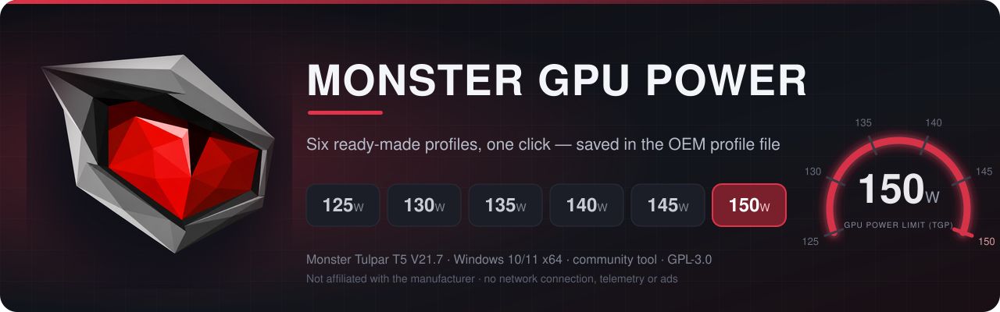
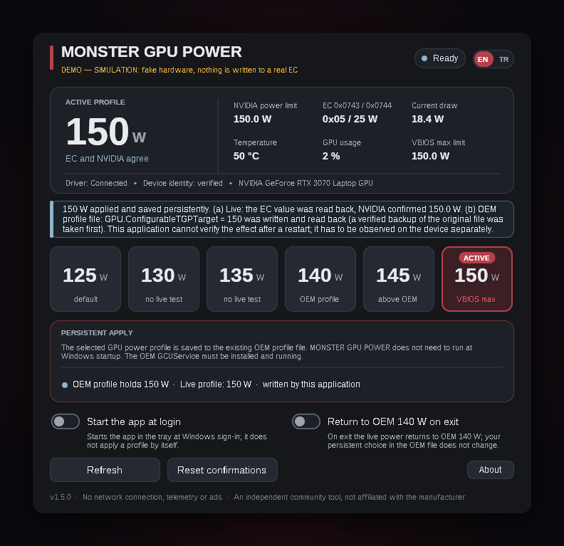
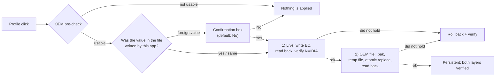

<div align="center">



<br>


**English** · [Türkçe](README.tr.md)

</div>

> [!WARNING]
> **This tool targets exactly one machine:** Monster Tulpar T5 V21.7 (board tag GM5TG7Y), BIOS `N.1.07Mon08`, NVIDIA GeForce RTX 3070 Laptop GPU (VBIOS maximum 150 W).
> On any other model, BIOS or GPU the application **deliberately writes nothing** (see [Compatibility](#compatibility)). Raising the GPU power limit above 140 W means more heat, fan noise and VRM load and may affect your warranty. You use it at your own risk ([Disclaimer](#disclaimer)).

## What is it?

**MONSTER GPU POWER** is a small Windows application that lets you pick the GPU power limit (TGP) of the Monster Tulpar T5 V21.7 — **125, 130, 135, 140, 145 or 150 W** — with a single click. The profile you pick is **applied immediately and saved to the OEM profile file**, so you do not need to run the application after a restart.

The interface is available in **English and Turkish**. You choose the language in the installer, and you can switch it at any time with the small **EN | TR** switch in the top-right corner of the window (the installed and the portable version behave the same).

<div align="center">


<sub>Main window. <b>This image is not from real hardware: it was taken from the SIMULATION (demo) build</b> (fake EC / NVIDIA / OEM file); the build label is shown in the window as well.</sub>
</div>

## Features

- **Six ready-made profiles, one click.** 125 · 130 · 135 · 140 · 145 · 150 W. Every click is persistent; there is no "temporary" apply.
- **Two-layer, verified result.** First the live value (EC + NVIDIA driver, read back and verified), then the OEM profile file (written and read back). "Success" is never reported unless both layers are verified; if one fails, the live change is **rolled back** and the rollback is verified too.
- **Backup before writing.** Before every change to the OEM file, a full copy of the original file is saved next to it as a `.bak`; backups are never deleted or overwritten.
- **Foreign-value protection.** If the value in the file was not written by this application (Control Center, an OEM update, a manual edit…), it asks before overwriting it; the default answer is **No**.
- **Temperature and limit guards.** Profiles above 140 W are not applied while the GPU is at 80 °C or higher; anything above the maximum limit reported by NVIDIA is refused.
- **Device identity check.** If SMBIOS, the BIOS version or the GPU model do not match, nothing is written.
- **English / Turkish interface.** Language choice in the installer, EN | TR switch in the window, remembered between runs.
- **Few settings, that is all:** *Start the app at login*, *Return to OEM 140 W on exit* and the language switch.
- The small **About** button opens this page.
- **No network, no telemetry, no ads.** The application never connects to the internet.
- **No shell.** It does not run PowerShell, CMD, Python or any helper program; it reaches the EC through the driver device and the OEM file with direct file operations.

## Profiles

| Profile | EC `0x0743` / `0x0744` | UI label | Evidence level (the device owner's measurements) |
|:---:|:---:|---|---|
| **125 W** | `0x01` / 0 | default | measured live with OEM AutomaticOverboost off |
| **130 W** | `0x05` / 5 | not tried live | **Expected mapping; not tried live** |
| **135 W** | `0x05` / 10 | not tried live | **Expected mapping; not tried live** |
| **140 W** | `0x05` / 15 | OEM profile | measured live with OEM on (the highest profile the manufacturer specifies) |
| **145 W** | `0x05` / 20 | above OEM | EC + NVIDIA verified (idle polling) |
| **150 W** | `0x05` / 25 | VBIOS maximum | EC + NVIDIA verified; ~150 W measured under load |

For 145 W and 150 W, and the first time for 130/135 W, the application shows a warning/confirmation box; your confirmation is remembered and can be undone with "Reset confirmations".

## How it works



If the OEM profile file is missing or not in the expected state (conditions below), **nothing is applied**: the application never makes a live-only, non-persistent change.

### What does persistence rely on?

Persistence is **not** a write to the EC or the BIOS. The mechanism is:

1. The manufacturer's Control Center `GCUService` service applies the JSON file of the active OEM profile.
2. This application changes the three digits of **a single field** (`GPU.ConfigurableTGPTarget`) in that file; every other byte of the file is preserved.
3. So at Windows startup the OEM service applies the GPU power limit; this application does not need to be running.

> The selected GPU power profile is saved to the existing OEM profile file. MONSTER GPU POWER does not need to run at Windows startup. The OEM GCUService must be installed and running.

A write is made only if **all** of the following conditions hold (otherwise the window states the reason and nothing is applied):

| Condition | Expected |
|---|---|
| Privileges | the application runs as administrator (the manifest requests it) |
| Service | `GCUService.exe` is running; full path `C:\Program Files\OEM\Control Center\UniwillService\MyControlCenter\GCUService.exe` |
| Service version | **1.0.2.70** only |
| Folder | `…\MyControlCenter\UserPofiles` (the OEM's spelling, verbatim) is a real folder; no link / junction |
| Active profile | in `MainOption.json`: `OperatingMode = 2`, `TurboProfileIndex = 0` → the active profile is `Mode3_Profile1.json` |
| Profile file | `Activated = true`, `GPU.ConfigurableTGPSwitch = 1`, `GPU.DynamicBoostSwitch = 0`, `GPU.ConfigurableTGPTarget` is one of 125–150 W |

### What does it change and what does it not?

| It changes | It does not change |
|---|---|
| EC `0x0743` and `0x0744` live power registers (allow-listed values only) | BIOS / UEFI and the EC **firmware** (there is no flash write at all) |
| `Mode3_Profile1.json` → `GPU.ConfigurableTGPTarget` (3 digits) | `MainOption.json` and every other field and byte of the file |
| `Mode3_Profile1.json.mgp-original-<date>-<code>.bak` backups in the same folder | The OEM service itself, drivers, OEM registry keys |
| Settings and log files under `%LOCALAPPDATA%\MonsterGpuPower\` | 230 W / 330 W adapter profiles, CPU power limits, fan curves |
| A Task Scheduler task (`MonsterGpuPower_Autostart`) if *Start the app at login* is turned on | NVIDIA settings (`nvidia-smi -pl` etc. is not used) |

## Compatibility

| Item | Supported (the only target) |
|---|---|
| Computer | manufacturer `MONSTER`, model `TULPAR T5 V21.7…` (SMBIOS) |
| Board tag | `GM5TG7Y` (if it does not appear in SMBIOS the application asks for a one-time confirmation) |
| BIOS | `N.1.07Mon08` (exact) |
| GPU | NVIDIA GeForce RTX 3070 **Laptop**, VBIOS maximum power limit **150 W** |
| Driver | Uniwill `ACPIDriver` (`ACPI\INOU0000`) installed and running |
| OEM software | Control Center `GCUService` **1.0.2.70** |
| Operating system | Windows 10 / 11 x64 |

**Not supported (blocked on purpose):** other models of the same Tongfang GM5 chassis family such as the XMG NEO 15 (M21) / GM5TG7W, other brands sharing the platform, RTX 3060/3080 variants, different BIOS versions. Their EC mapping and OEM file structure are not verified; the application disables the profile buttons and writes nothing. We do not recommend removing the identity check to "try" an unsupported device.

If you have another device and would like support, you can open an [Issue](../../issues/new?template=compatibility-report.md) with the output of the read-only commands below; this is data for evaluation, not a promise of support.

### GPU VBIOS note

This application does **not** touch the VBIOS: it does not run `nvflash`, does not distribute VBIOS files and does **not recommend** changing the VBIOS. The upper bound of the profiles is the power limit the VBIOS allows; if the NVIDIA driver does not report a maximum limit of **150 W**, the application refuses to write on that device. So being able to reach 150 W depends on the GPU already running a VBIOS with a 150 W maximum.

On the author's own device a 150 W VBIOS from another vendor (MECHREVO GM7TG7M) is installed. That is **the author's own choice and risk**; it is not a recommendation. The author's observation is that even with a 150 W VBIOS the GPU cannot actually reach 150 W unless the extra power share controlled by the OEM (EC `0x0743` / `0x0744`) is opened. This application adjusts that OEM share and makes it persistent in the OEM profile file. It does not patch the NVIDIA driver: when the share in the EC changes, the driver updates the limit it reports, and the application verifies that by reading it through NVML.

VBIOS pages the author added as references (their content is **not verified** by this project; a wrong VBIOS can make the GPU unusable and voids the warranty):

* MECHREVO 150 W: <https://www.techpowerup.com/vgabios/249133/249133>
* Clevo 150 W: <https://www.techpowerup.com/vgabios/256918/256918>

The author's notes: for VBIOS experiments only files with matching Device ID and Subsystem ID should be considered, and the MUX switch should be off during the experiment. Not every upload on TechPowerUp is verified.

### Check your device (read-only PowerShell)

Run these in a PowerShell opened as administrator. They **change nothing**, they only read. (These commands could not be run on a real Windows/PowerShell while this page was prepared; syntax and field names were only compared against the code. If you see an inconsistency in the output, please report it.)

```powershell
# 1) Device identity  → expected: MONSTER | TULPAR T5 V21.7… | GM5TG7Y | N.1.07Mon08
$cs = Get-CimInstance Win32_ComputerSystem
$bb = Get-CimInstance Win32_BaseBoard
$bi = Get-CimInstance Win32_BIOS
"Manufacturer: $($cs.Manufacturer)"
"Model       : $($cs.Model)"
"Board       : $($bb.Product)"
"BIOS        : $($bi.SMBIOSBIOSVersion)"

# 2) GPU  → expected: …RTX 3070 Laptop GPU… and power.max_limit = 150.00 W
nvidia-smi --query-gpu=name,power.limit,power.default_limit,power.max_limit --format=csv

# 3) ACPIDriver  → expected: Status = OK
Get-PnpDevice | Where-Object { $_.InstanceId -like 'ACPI\INOU0000*' } |
    Select-Object Status, FriendlyName, InstanceId

# 4) OEM service  → expected: path as below, FileVersion = 1.0.2.70
$p = Get-Process -Name GCUService -ErrorAction SilentlyContinue
if ($p) { $p.Path; (Get-Item $p.Path).VersionInfo.FileVersion } else { 'GCUService is not running' }

# 5) OEM profile files  → expected: OperatingMode 2, TurboProfileIndex 0, Activated true,
#    ConfigurableTGPSwitch 1, DynamicBoostSwitch 0, ConfigurableTGPTarget 125..150
$d = 'C:\Program Files\OEM\Control Center\UniwillService\MyControlCenter\UserPofiles'
Select-String -Path "$d\MainOption.json"       -Pattern 'OperatingMode|TurboProfileIndex'
Select-String -Path "$d\Mode3_Profile1.json"   -Pattern '"Activated"|ConfigurableTGPSwitch|DynamicBoostSwitch|ConfigurableTGPTarget'
```

If `nvidia-smi` is not found, try `C:\Windows\System32\nvidia-smi.exe`. If all five checks match the expectations, your device passes the application's identity check; we cannot say that this means **the application will run flawlessly on real hardware** (see [Validation status](#validation-status)).

## Installation

1. From the [Releases](../../releases/latest) page download `MONSTER_GPU_POWER_Setup.exe` (installer) or `MonsterGpuPower.exe` (portable / standalone) and compare it with `SHA256SUMS.txt`.
   ```powershell
   Get-FileHash .\MONSTER_GPU_POWER_Setup.exe -Algorithm SHA256
   ```
2. Run it. The application asks for administrator rights (needed for the EC device and the OEM folder).
3. It is not code-signed: Windows SmartScreen may show an "unknown publisher" warning.

The installer asks for the **language** first (English or Türkçe) and optionally adds Start menu / desktop shortcuts. The language you pick becomes the default interface language of the installed application; you can still change it with the EN | TR switch afterwards. The portable `MonsterGpuPower.exe` needs no installation: it starts in your Windows display language (Turkish if Windows is Turkish, otherwise English) and has the same EN | TR switch.

### Driver dependency

The application reaches the EC through the Uniwill **`ACPIDriver`** kernel driver (`\\.\ACPIDriver`). This driver belongs to the manufacturer; it is **not included in and not distributed from** this repository. If the driver is not installed, the application states the reason and does nothing. It does not need Control Center's DLLs, but for persistence Control Center's `GCUService` service is **required** (conditions above). Details and the IOCTL/EC map: [docs/DRIVER_ABI.md](docs/DRIVER_ABI.md).

## Usage

1. Open the application; the status strip at the top shows the device identity, the driver and the OEM profile state.
2. Click one of the six profile buttons. A confirmation box appears when needed.
3. The result line reports the two layers separately: *(a) live EC + NVIDIA* and *(b) OEM profile file*.
4. **Refresh** re-reads the state; **Reset confirmations** undoes the confirmations you gave; **About** opens this page; **EN | TR** switches the interface language (the last result message is re-rendered in the new language).

### Settings

| Setting | What it does |
|---|---|
| **Start the app at login** | Starts the application in the tray when you log in to Windows (Task Scheduler, ~10 s delay). **It does not apply any profile by itself**; the profile is already persistent in the OEM file. |
| **Return to OEM 140 W on exit** | When you exit the application, sets the **live** value back to OEM 140 W. It does **not change** your persistent choice in the OEM file; so when the OEM service re-reads the file, your selected value may come back. |
| **EN \| TR** | Interface language. Stored in `%LOCALAPPDATA%\MonsterGpuPower\settings.ini` (`language=`). Default order: your own choice → the language chosen in the installer → Windows display language (Turkish → TR, otherwise EN). If you reinstall and pick a different language in the installer, the new installer choice wins once. |

### Manual rollback

There are two ways to go back to the OEM default (140 W):

- **With the application:** select the 140 W profile. The target in the file becomes 140 (a backup is taken first again).
- **By hand:** with the application closed, you will see the `Mode3_Profile1.json.mgp-original-…bak` backups in the `…\MyControlCenter\UserPofiles` folder. Copy the backup you want back as `Mode3_Profile1.json` (as administrator). No backup is ever deleted automatically.

Uninstalling the application does not touch the OEM file or the backups; the profile you selected stays in the file. Before uninstalling, select 140 W or put a backup back by hand.

### Upgrading from earlier versions (v1.0–v1.4)

v1.4.0 **removed** *temporary apply*, *apply at Windows startup*, *monitor external changes / re-apply automatically*, *re-apply when the screen turns on*, opening the log and the diagnostics report; the profile is now always persistent. The installer **deletes** the `MonsterGpuPower_ApplyAtLogon` Task Scheduler task of the old versions (without applying any profile). Old settings keys are ignored.

v1.5.0 adds the English / Turkish interface and installer language choice; nothing else about writing or persistence changed compared to v1.4.0. An existing `settings.ini` from v1.4.0 keeps working (it simply has no language entry yet).

## Validation status

The honest summary: **the application has not yet been run on real hardware.**

| What | Status |
|---|---|
| Unit tests (ASan + UBSan) | **110 tests / 2250 checks passed** (JSON parsing, the safe-write algorithm, failure cases, state classification, UI texts never claiming "EC/BIOS persistent", language resolution, both-language text completeness) |
| Wine + fake-hardware end-to-end GUI test | **211 checks passed, 0 failed** — *simulation* (Wine 9, fake EC/NVIDIA/OEM folder), including language detection, the EN | TR switch, English text without Turkish leftovers and DPI layout in both languages |
| Installer (silent install + upgrade from older versions + interactive wizard + uninstall) | silent install **30/30**, upgrades from v1.3.0 (**15/15**) and v1.4.0 (**14/14**), interactive wizard with the language page **4/4** per language passed — in Wine, *simulation* |
| PE verification | x64, GUI subsystem, ASLR/DEP, administrator manifest, no network DLL imports, no demo code in the production EXE |
| **Real Windows 10/11 + a real GM5TG7Y** | ❌ **NOT TRIED**: no real EC write and no real OEM JSON write was made with this application |
| Real Task Scheduler behaviour | ❌ Not tried (only partial emulation / a file-based fake store in Wine) |
| Language auto-detection on a real Windows (system locale, installer registry value) and the installer wizard's language page | ❌ Not tried on real Windows; tested in Wine (the wizard was driven interactively, the Windows language was simulated, the registry value was a Wine registry value) |
| Reboot persistence of 125/130/135/145 W | ❌ Not tried. The device owner tried the same mechanism (140 → 150 W in the JSON) with their own PowerShell script and observed that 150 W survived screen cycles and restarts; this application's code is the C++ counterpart of that script and has not been run on a real device |
| *When* GCUService reads the file | Unknown; the application cannot verify the effect after a restart and does not pretend to |
| **About** opening the browser from the elevated process | The click was verified from the log in Wine; not tried on real Windows |

Suggested steps to see persistence working on your own device: [docs/DEVICE_ACCEPTANCE_TEST.md](docs/DEVICE_ACCEPTANCE_TEST.md). Detailed test record: [docs/TEST_STATUS.md](docs/TEST_STATUS.md).

## Reporting problems

When you [open an Issue](../../issues), include: your Windows version, the PowerShell outputs above, and the log file `%LOCALAPPDATA%\MonsterGpuPower\logs\mgp.log`. The log contains no serial number, MAC address or user name; still, review it before sharing.

## Building from source

On Linux (mingw-w64 cross compiler + NSIS):

```bash
make test        # unit tests (on the host, ASan+UBSan)
make exe         # build/MonsterGpuPower.exe
make installer   # build/MONSTER_GPU_POWER_Setup.exe (NSIS)
python3 -I tools/verify_pe.py build/MonsterGpuPower.exe
```

On Windows, in an MSYS2 mingw64 shell use `make CROSS=` or `build.bat` (see the comments in the files). `make demo` produces a **SIMULATION** build with fake hardware (only for trying the UI and for tests; it is not distributed). Code layout: `src/core` (platform-independent logic: JSON, the write algorithm, state classification, identity check, language resolution), `src/win` (Win32 UI, driver/NVML/OEM file layer, all UI texts in `strings.h`), `tests/` (unit tests). Source code comments are mostly in Turkish.

## Next stages

Ideas outside the scope of this version (shared CPU/GPU power budget, a Control Center alternative, advanced BIOS menus) exist only as research notes in [docs/NEXT_STAGES.md](docs/NEXT_STAGES.md); **they are not in this application and are not promised.**

## Privacy

The application does not connect to the network and does not collect or send data. It only writes a local settings/log file. The source code is open under GPL-3.0.

## License

[GNU GPL v3.0](LICENSE)

## Disclaimer

This is an independent community project; it is **not affiliated with, endorsed by or supported by** Monster Notebook, Casper, Uniwill, XMG, Tongfang, NVIDIA or Microsoft. The respective brands belong to their owners. The software is provided "as is" without any warranty. Changing power limits can stress your hardware thermally and electrically, may affect your warranty and may lead to data or hardware loss. Check your own device before using it, save your important work and accept the risk yourself.
